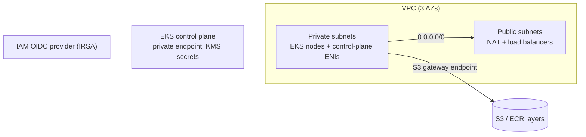

# AWS EKS Platform (Terraform)

A production-style Amazon EKS platform built from plain Terraform resources (no community wrapper modules), so every security and networking decision is visible in the code.

## What it builds



**Networking (`modules/vpc`)**
- Three-AZ VPC with public and private subnets, tagged for AWS Load Balancer Controller and Karpenter discovery.
- Single or per-AZ NAT gateways (a cost/availability toggle).
- S3 gateway endpoint so image pulls and log shipping skip NAT charges.
- VPC flow logs to CloudWatch.

**Cluster (`modules/eks`)**
- Private-only API endpoint by default (reach it over VPN or a bastion).
- Kubernetes Secrets envelope-encrypted with a rotating KMS key.
- All five control-plane log types sent to CloudWatch with retention.
- EKS access entries (`authentication_mode = "API"`) instead of the `aws-auth` ConfigMap.
- IRSA via an IAM OIDC provider; the VPC CNI runs with its own scoped role rather than the node role.
- Managed node group on a launch template with IMDSv2 enforced (hop limit 1), encrypted gp3 volumes, SSM access instead of SSH, and Spot support.
- Managed add-ons: vpc-cni, coredns, kube-proxy, eks-pod-identity-agent.

**CI (`.github/workflows/terraform.yml`)**
- `terraform fmt`, `terraform validate`, TFLint with the AWS ruleset, and a Checkov security scan on every pull request.

## Layout

```
modules/
  vpc/        # network foundation
  eks/        # cluster, IAM, node group, add-ons
envs/
  staging/    # composes the modules for one environment
```

Adding `envs/prod` means copying `staging`, setting `single_nat_gateway = false`, `node_capacity_type = "ON_DEMAND"`, and pointing the S3 backend at a separate state key.

## Usage

```bash
cd envs/staging
cp terraform.tfvars.example terraform.tfvars   # set your admin role ARN
terraform init
terraform plan -out=tfplan
terraform apply tfplan
aws eks update-kubeconfig --region us-west-2 --name platform-staging
```

Remote state: create an S3 bucket (versioning + encryption on) and a DynamoDB table with a `LockID` string key, then uncomment the `backend "s3"` block in `envs/staging/versions.tf`.

> Running `apply` creates billable AWS resources (EKS control plane, NAT gateway, EC2). Run `terraform destroy` when finished.

## Roadmap
- Karpenter for node autoscaling
- AWS Load Balancer Controller and ExternalDNS via IRSA
- Argo CD for GitOps app delivery
- Prometheus/Grafana observability stack
